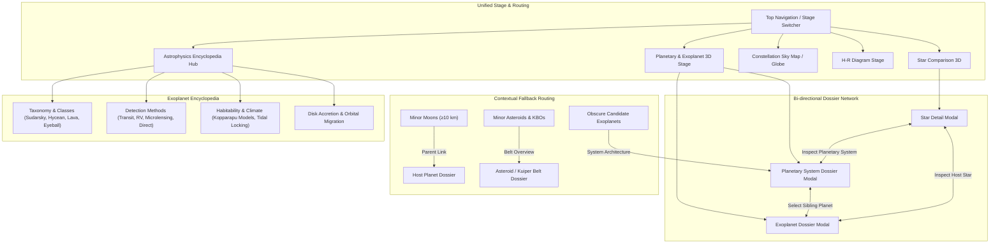

# Phase 3: Planetary & Exoplanetary Systems Full Integration Blueprint

> **Project:** Starpedia 3D (All-about-stars)  
> **Phase:** 3 (Exoplanet & Planetary System Full Integration)  
> **Status:** Approved / Planning to Execution  
> **Target Version:** v2.6.0  

---

## 1. Executive Summary & Vision

Phase 3 transitions Starpedia 3D from a dual-engine architecture (stars vs. isolated exoplanets) into a **single, unified astrophysical continuum**. By fully integrating the exoplanet stage with the main stellar stage, users can seamlessly transition across 9 orders of physical magnitude: from minor asteroids ($\ge 10\text{ km}$), moons, terrestrial worlds, and gas giants, all the way to solar-type stars, luminous blue variables, and red hypergiants.

### Key Deliverables:
1. **Full Integration with Main Stage (Zero Detachments):** Merge planetary comparison into the core app shell, top navigation, and WebGL lifecycle.
2. **Exoplanet Dossier Modal (`ExoplanetDossierModal.tsx`):** Research-grade individual dossier for verified exoplanets with physical, orbital, and atmospheric telemetry.
3. **Planetary System Dossier Modal (`PlanetarySystemDossierModal.tsx`):** Multi-planet architectural view displaying scaled semi-major axes, dynamic habitable zone bands, orbital resonances, and sibling rosters.
4. **Exoplanet Encyclopedia (`ExoplanetEncyclopedia.tsx`):** Standalone educational guide detailing taxonomy, detection methods, habitability thermodynamics, and planetary migration.
5. **Asteroid & Minor Planet Expansion ($\ge 10\text{ km}$):** Expand the solar system catalog with prominent Main Belt asteroids, irregular moons, Centaurs, Trojans, and comets down to 10 km.
6. **Robust 3-Tier Fallback Routing:** Contextual fallback mechanisms for minor moons, minor asteroids, and obscure exoplanet candidates.

---

## 2. Architectural Blueprint

---

## 3. Workstream Specifications

### Workstream 1: Asteroids & Minor Planets Dataset Expansion ($\ge 10\text{ km}$)
Expand `src/data/solarSystemCatalog.ts` and `src/data/masterCelestialCatalog.ts` to include verified physical, orbital, and spectral parameters for Solar System bodies $\ge 10\text{ km}$:

* **Main Asteroid Belt:**
  * Benchmark large asteroids: 1 Ceres, 4 Vesta, 2 Pallas, 10 Hygiea, 704 Interamnia, 52 Europa, 511 Davida, 3 Juno, 15 Eunomia.
  * Unique & metallic targets: 16 Psyche ($226\text{ km}$, core remnant), 31 Euphrosyne, 87 Sylvia, 216 Kleopatra (bilobate dog-bone), 243 Ida & Dactyl, 253 Mathilde, 951 Gaspra, 433 Eros ($16.8\text{ km}$).
* **Moons of Mars & the Outer Gas/Ice Giants:**
  * Mars: Phobos ($22.2\text{ km}$), Deimos ($12.4\text{ km}$).
  * Jupiter: Amalthea ($167\text{ km}$), Thebe, Himalia, Elara, Pasiphae, Sinope, Carme, Lysithea.
  * Saturn: Hyperion ($270\text{ km}$, chaotic porous sponge), Phoebe ($213\text{ km}$, retrograde captured KBO), Janus, Epimetheus, Prometheus, Pandora, Helene.
  * Uranus: Puck ($162\text{ km}$), Portia, Juliet, Belinda, Caliban, Sycorax.
  * Neptune: Proteus ($420\text{ km}$), Larissa, Galatea, Despina, Thalassa, Naiad, Nereid ($340\text{ km}$).
* **Trans-Neptunian Objects, Centaurs & Trojans:**
  * Dwarf planets & large Plutinos: 136199 Eris, 136108 Haumea, 136472 Makemake, 90377 Sedna, 225088 Gonggong, 50000 Quaoar, 90482 Orcus, 20000 Varuna, 28978 Ixion.
  * Centaurs & small KBOs: 2060 Chiron, 10199 Chariklo (ringed Centaur), 486958 Arrokoth ($36\text{ km}$, primordial contact binary), 624 Hektor (Trojan).
* **Notable Cometary Nuclei:**
  * 1P/Halley ($11\text{ km}$), 67P/Churyumov–Gerasimenko, Hale-Bopp.

---

### Workstream 2: Planetary & Exoplanet Dossier Modal (`ExoplanetDossierModal.tsx`)
A dedicated, research-grade modal component offering comprehensive telemetry, comparative scale visualization, and ring rendering:

* **Physical Scale Metric Convention (Diameter as Primary Unit):**
  * In alignment with the star dossier (`StarDetailModal.tsx`) and Starpedia 3D's size-comparison engine, **Diameter is the primary unit of physical size measurement** ($D_\odot, D_\oplus, D_{\text{Jup}}$, and physical kilometers/miles).
  * **Astrophysical Derivation:** While observational literature and catalogs (NASA Exoplanet Archive, Open Exoplanet Catalogue) publish the dimensionless scale as a radius ratio ($R/R_{\text{ref}}$), because $\frac{R}{R_{\text{ref}}} \equiv \frac{D}{D_{\text{ref}}}$, the physical diameter is computed directly by multiplying that known multiplier by the reference diameter:
    * **Earth Multipliers:** $\text{Diameter (km)} = \text{multiplier} \times D_\oplus = \text{multiplier} \times 12,742\text{ km}$
    * **Jupiter Multipliers:** $\text{Diameter (km)} = \text{multiplier} \times D_{\text{Jup}} = \text{multiplier} \times 139,820\text{ km}$
    * **Solar Multipliers:** $\text{Diameter (km)} = \text{multiplier} \times D_\odot = \text{multiplier} \times 1,392,700\text{ km}$
  * The dossier primary header and cards feature **Diameter** ($D_\oplus$, $D_{\text{Jup}}$, km), while the secondary breakdown table lists the derived **Radius** ($R = \frac{1}{2} D$) for complete astrophysical transparency.
* **Availability & Curated Coverage:**
  * **Major Solar System Bodies:** Sun, Mercury, Venus, Earth, Mars, Jupiter, Saturn, Uranus, Neptune, Pluto, Ceres, and landmark satellites (Moon, Titan, Europa, Ganymede, Enceladus, Callisto, Triton, Io).
  * **Landmark Benchmark Exoplanets:** Kepler-22b, Dimidium (51 Pegasi b), Janssen (55 Cancri e), Proxima Centauri b, TRAPPIST-1e, WASP-12b, Gliese 436 b, GJ 1214 b, Kepler-186f, HD 189733 b, Osiris (HD 209458 b), KELT-9b, LHS 3844 b, etc.
* **Interactive 3D Dossier Stage & Dynamic Scaling Logic:**
  * **Solar System Planets with Moons (Default View):** Displays the planet in orbital context with its key natural satellites (e.g., Earth with the Moon; Mars with Phobos & Deimos; Jupiter with the 4 Galilean moons; Saturn with Titan, Enceladus, Rhea, Dione; Uranus with Titania, Oberon, Miranda; Neptune with Triton; Pluto with Charon).
  * **Exoplanets & Moonless Bodies (Comparative Reference):**
    * *Smaller Worlds ($R_p < 4.0\,R_\oplus$, Terrestrial / Super-Earths / Sub-Neptunes):* Rendered side-by-side with **Earth** ($1.0\,R_\oplus$) for immediate intuitive scale.
    * *Colossal Worlds ($R_p \ge 4.0\,R_\oplus$, Gas Giants / Jovians / Brown Dwarfs):* Rendered side-by-side with **Jupiter** ($1.0\,R_{\text{Jup}} \approx 11.21\,R_\oplus$) for true Jovian scale perception.
* **Dossier-Exclusive Planetary Rings:**
  * Planetary ring meshes and procedural ring shaders are **strictly rendered in the dossier only** (preserving diameter measurement clarity on the main linear/spiral stage).
  * Accurate ring geometry and opacity calibrated for the four Jovian ringed planets:
    1. **Saturn:** Iconic high-albedo A, B, and C rings with the Cassini Division.
    2. **Uranus:** Tilted, narrow, dark carbonaceous $\epsilon$-rings.
    3. **Jupiter:** Translucent, faint Jovian dust/gossamer ring sheet.
    4. **Neptune:** Clumpy, dark azure dust arcs (Adams, Le Verrier rings).
* **Physical & Environmental Telemetry:**
  * Radius ($R_\oplus$, $R_{\text{Jup}}$, km, miles), Mass ($M_\oplus$, $M_{\text{Jup}}$, kg), Mean Density ($\text{g/cm}^3$), Surface Gravity ($\log g$, $\text{m/s}^2$, $g$-fraction), Escape Velocity ($v_{\text{esc}}$ in km/s).
  * Equilibrium Temperature ($T_{\text{eq}}$ in K, °C, °F), Stellar Insolation Flux ($S_{\text{eff}} / S_\oplus$), Geometric Albedo, Atmospheric Scale Height ($H = k_B T / \mu g$).
  * Kopparapu Habitability Limits & classification (Recent Venus, Runaway Greenhouse, Conservative HZ, Maximum Greenhouse, Early Mars, or Non-Habitable).
* **Direct Bidirectional Portals:**
  * One-click action to inspect the **Host Star** in `StarDetailModal.tsx`.
  * One-click action to view the entire **Planetary System** in `PlanetarySystemDossierModal.tsx`.

---

### Workstream 3: Planetary System Dossier Modal (`PlanetarySystemDossierModal.tsx`)
A dedicated multi-planet system architecture modal supporting major benchmark systems (Solar System, TRAPPIST-1, Kepler-90, HR 8799, 55 Cancri, Gliese 667 C, Kepler-11, TOI-700, etc.):
* **Scaled Orbital Architecture View:** Interactive 2D/3D diagram plotting semi-major axes ($a$ in AU) from the parent star outwards.
* **Habitable Zone Overlay:** Dynamically calculated conservative and optimistic habitable zone green bands based on host star luminosity and effective temperature.
* **Resonance & Synchrony Indicators:** Visual indicators for orbital resonance chains (e.g. TRAPPIST-1's 8:5, 5:3, 3:2 Laplace-like chain; Galilean moon resonance).
* **System Planetary Roster:** Sortable tabular breakdown of all sibling planets with one-click navigation to each planet's dossier.
* **Host Star Summary:** Host star spectral type, metallicity, age, and direct portal to `StarDetailModal`.

---

### Workstream 4: The 3-Tier Fallback Engine
To prevent empty states or confusing single-metric cards, implement an intelligent contextual fallback engine:

1. **Tier 1: Minor Moons ($\ge 10\text{ km}$):**
   * Bodies such as Phobos, Deimos, Amalthea, or Hyperion present their physical metrics alongside a prominent parent banner: *"Satellite of [Host Planet]"*.
   * Includes a primary action button: **"Open Host Planet Dossier"** (e.g., Phobos opens Mars; Amalthea opens Jupiter).
2. **Tier 2: Minor Asteroids, KBOs & Comets:**
   * Small asteroids provide physical dimensions, spectral taxonomy (C/S/M-type), and an immediate context banner: *"Main Asteroid Belt Object"* or *"Kuiper Belt Object"*.
   * Includes a primary action button: **"Open Asteroid Belt / Kuiper Belt Dossier"** explaining Kirkwood gaps, orbital families, and formation dynamics.
3. **Tier 3: Obscure / Faint Exoplanet Candidates:**
   * For single-metric Kepler/TESS candidates lacking individual lore, the modal gracefully surfaces available parameters and falls back into the **Planetary System Dossier**, highlighting the parent star and full system architecture.

---

### Workstream 5: Exoplanet Encyclopedia (`ExoplanetEncyclopedia.tsx`)
Integrated into `EncyclopediaDropdown.tsx` alongside the stellar guides:
1. **Taxonomy & Classification:** Detailed breakdowns of Terrestrial, Ocean/Hycean, Sub-Neptunes, Jovians, Sudarsky Classes (I through V), Ultra-hot Jupiters, Lava Worlds, and Rogue Planets.
2. **Detection Science:** Mathematical formulations and observational walk-throughs for Transit Photometry, Radial Velocity, Gravitational Microlensing, Direct Imaging, and Transmission Spectroscopy.
3. **Habitability & Climate Dynamics:** Atmospheric escape mechanisms, tidal locking, substellar heat redistribution, and runaway greenhouse triggers.
4. **Planetary Formation & Migration:** Core accretion vs. pebble accretion, protoplanetary disk snow lines, and Type I/II migration.

---

### Workstream 6: Full Integration with Main Stage & Star Catalog
* **100% Exoplanet Mass Prerequisite (Completed):** Populated `massEarth`, `massJupiter`, and `massType` (`'measured'` vs. `'estimated'`) for all 35 previously unweighed exoplanets in `src/data/exoplanetCatalog.json` (12 peer-reviewed RV/TTV/JWST determinations and 23 Chen & Kipping 2017 mass–radius estimates), achieving 100% mass coverage across all 2,095 exoplanets and 47 Solar System bodies.
* **App Shell Stage Routing:** Unify stage switching in `App.tsx` between Stars, Planets/Exoplanets, Constellation Globe, and H-R Diagram.
* **StarDetailModal Cross-Linking & Record Normalization:** Normalize the 19 `ExoplanetRecord` sub-entries in `src/data/starDatabase.json` that carry numeric `massEarth` into standard `ExoplanetRecord` `mass` strings upon branch merge, and add a direct **"Explore Planetary System (X Planets)"** portal on host stars (`Sun`, `Proxima`, `TRAPPIST-1`, `51 Pegasi`, `Kepler-186`, etc.).
* **Performance & Safety:** Ensure complete WebGL resource disposal (`geometry.dispose()`, `material.dispose()`, `texture.dispose()`) via `canvasSafety.ts` on stage switches.

---

### Workstream 7: Central Command Palette & Search Indexing
* Index all 48+ Solar System bodies, expanded minor asteroids, landmark exoplanets, and multi-planet systems in `CommandPaletteModal.tsx` (<kbd>Ctrl+K</kbd> / <kbd>/</kbd>).
* Add categorical badges (`Solar System`, `Exoplanet`, `Planetary System`, `Asteroid / KBO`) for intuitive discovery.

---

## 4. Execution Roadmap

| Step | Milestone | Focus Areas | Deliverables |
|:---:|:---|:---|:---|
| **Phase 3.1** | **Dataset Expansion & Types** | `solarSystemCatalog.ts`, `types.ts`, `masterCelestialCatalog.ts` | 50+ new asteroids/moons ($\ge 10\text{ km}$), spectral classifications, belt mappings. |
| **Phase 3.2** | **Dossier & Fallback Engine** | `ExoplanetDossierModal.tsx`, `PlanetarySystemDossierModal.tsx` | Full individual telemetry, orbital tracks, HZ bands, and 3-tier fallback routing. |
| **Phase 3.3** | **Exoplanet Encyclopedia** | `ExoplanetEncyclopedia.tsx`, `EncyclopediaDropdown.tsx` | 4-section educational guide with diagrams, equations, and interactive specimen launches. |
| **Phase 3.4** | **Main Stage Integration** | `App.tsx`, `ExoplanetCanvas3D.tsx`, `StarCanvas3D.tsx` | Unified stage switching, WebGL lifecycle safety, and audio engine hookups. |
| **Phase 3.5** | **Cross-Catalog Synergy & Search** | `StarDetailModal.tsx`, `CommandPaletteModal.tsx` | Host star ↔ planetary system links, global search indexing, and keyboard shortcut alignment. |
| **Phase 3.6** | **QA, Benchmarks & Delivery Gate** | Vitest/tsc, 25–60 FPS profiling, mobile responsive check | Full build pass, zero memory leaks, and anti-slop verification. |

---

## 5. Architectural Invariants (RULES.md Compliance)

1. **Asset Reuse (Rule #1):** Reuse textures in `public/textures/planets/` and procedural shader routines in `planetShaderUtils.ts`.
2. **Performance Target (Rule #2):** Maintain 25–60 FPS across all viewports; throttle DPR on intensive passes.
3. **Audio Single-Context (Rule #1):** Route all audio through `spaceAudioEngine.ts`; never create duplicate `AudioContext` instances.
4. **Decouple Tickers (Rule #7):** Keep 60 FPS animation/rotation loops inside `useRef` rather than React state.
5. **No Redundancy (Rule #4):** Consolidate UI controls into existing header menus and command palette without introducing clutter.
