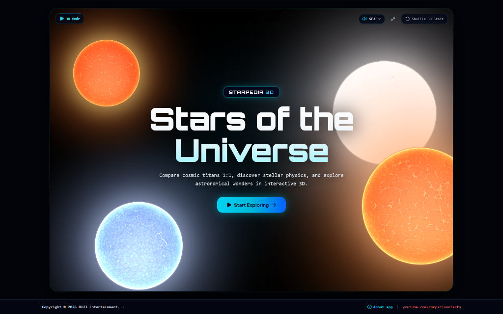

# Starpedia 3D: Stars of the Universe

<div align="center">



**An Interactive WebGL 3D Astrophysical Comparator, Stellar Catalog, Hertzsprung–Russell Kinematics Engine, and Celestial Atlas**

[](https://react.dev/)
[](https://www.typescriptlang.org/)
[](https://threejs.org/)
[](https://tailwindcss.com/)
[](https://vitejs.dev/)
[-06B6D4?style=for-the-badge)](https://github.com/thisisbarbelixir123/All-about-stars)
[](https://web.dev/progressive-web-apps/)
[](LICENSE)

🌐 **Live Production Application:** [https://starpedia3d.vercel.app/](https://starpedia3d.vercel.app/)  
📂 **Source Code Repository:** [https://github.com/thisisbarbelixir123/All-about-stars](https://github.com/thisisbarbelixir123/All-about-stars)

</div>

---

## 📑 Table of Contents

- [1. Executive Overview](#1-executive-overview)
- [2. Theoretical & Astrophysical Foundations](#2-theoretical--astrophysical-foundations)
  - [2.1 Stellar Radiation, Stefan–Boltzmann Law & D65 Colorimetry](#21-stellar-radiation-stefanboltzmann-law--d65-colorimetry)
  - [2.2 Hydrostatic Equilibrium & Interior Transport Dynamics](#22-hydrostatic-equilibrium--interior-transport-dynamics)
  - [2.3 Thermonuclear Nucleosynthesis & Reaction Networks](#23-thermonuclear-nucleosynthesis--reaction-networks)
  - [2.4 Degeneracy Physics & Compact Stellar Remnants](#24-degeneracy-physics--compact-stellar-remnants)
  - [2.5 Stellar Variability & the $\kappa$-Mechanism](#25-stellar-variability--the-kappa-mechanism)
  - [2.6 Exoplanetary Architecture & Habitable Zone Thermodynamics](#26-exoplanetary-architecture--habitable-zone-thermodynamics)
  - [2.7 Keplerian Two-Body & Hierarchical Orbital Mechanics](#27-keplerian-two-body--hierarchical-orbital-mechanics)
- [3. Complete Architectural & Functional Breakdown](#3-complete-architectural--functional-breakdown)
  - [3.1 3D Multi-Star Comparative Stage (WebGL/Three.js)](#31-3d-multi-star-comparative-stage-webglthreejs)
  - [3.2 Interactive Hertzsprung–Russell (H–R) Diagram](#32-interactive-hertzsprungrussell-hr-diagram)
  - [3.3 Comprehensive Stellar Catalog (885 Celestial Bodies)](#33-comprehensive-stellar-catalog-885-celestial-bodies)
  - [3.4 Dedicated Multiple Star Systems Catalog & 3D Orbital Simulation (53 Systems)](#34-dedicated-multiple-star-systems-catalog--3d-orbital-simulation-53-systems)
  - [3.5 88 IAU Constellations Sky Atlas & Celestial Sphere](#35-88-iau-constellations-sky-atlas--celestial-sphere)
  - [3.6 Standalone Stellar Classification & Taxonomy Guide](#36-standalone-stellar-classification--taxonomy-guide)
  - [3.7 Dedicated Stellar Nomenclature Guide](#37-dedicated-stellar-nomenclature-guide)
  - [3.8 Interactive Astrophysical Encyclopedia & Simulation Engines](#38-interactive-astrophysical-encyclopedia--simulation-engines)
  - [3.9 Stellar Suika: Cosmic Star Merge Minigame](#39-stellar-suika-cosmic-star-merge-minigame)
  - [3.10 Unified Procedural Web Audio Engine & Audio Popover Menu](#310-unified-procedural-web-audio-engine--audio-popover-menu)
  - [3.11 Ergonomics, Dynamic Marquee Engine (RunningText) & Fullscreen Mode](#311-ergonomics-dynamic-marquee-engine-runningtext--fullscreen-mode)
  - [3.12 Official About, Scientific Credits & Provenance System](#312-official-about-scientific-credits--provenance-system)
- [4. Software Architecture & Implementation Details](#4-software-architecture--implementation-details)
- [5. Empirical Data Sources & Reduction Pipeline](#5-empirical-data-sources--reduction-pipeline)
- [6. Installation & Local Development](#6-installation--local-development)
- [7. Global Keyboard Shortcuts Matrix](#7-global-keyboard-shortcuts-matrix)
- [8. Academic References & Citations](#8-academic-references--citations)
- [9. Provenance, Inspirations & License](#9-provenance-inspirations--license)

---

## 1. Executive Overview

**Starpedia 3D: Stars of the Universe** is a research-grade, highly interactive 3D astrophysics visualizer, stellar database, and cosmic scale explorer. Designed to solve one of the greatest pedagogical challenges in observational astronomy—**the human inability to intuitively comprehend astronomical dynamic ranges**—Starpedia 3D spans physical spatial scales over nine orders of magnitude: from sub-kilometer relativistic neutron stars and Earth-sized degenerate white dwarfs, to main-sequence dwarfs, luminous blue variables, and colossal red hypergiants exceeding $1.5 \times 10^9\text{ km}$ ($10\text{ AU}$) in diameter.

Unlike conventional static astronomy applications, Starpedia 3D synthesizes:
1. **Empirical Astrometry & Photometry:** Curated parameters for **885 stars** and **53 gravitationally bound multiple systems** compiled from the European Space Agency (ESA) Gaia DR3, Hipparcos, the CDS SIMBAD database, and the NASA Exoplanet Archive.
2. **First-Principles Theoretical Modeling:** Real-time computation of bolometric luminosities, effective surface temperatures, surface gravity ($\log g$), habitable zone radiative boundaries, and Keplerian orbital state vectors.
3. **Hardware-Accelerated WebGL/Three.js Rendering:** Custom GLSL shaders modeling limb darkening, photospheric convective granulation noise, translucent coronal plasma halos, relativistic pulsar synchrotron beams, and Roche-lobe-overflow contact binary geometries.
4. **Interactive Educational Visualizers:** Deep dives into thermonuclear fusion networks ($p\text{--}p$ chains, CNO cycle, $3\alpha$, silicon burning), stellar cross-sectional interior cutaways, mass-dependent evolutionary pathways, and the 88 International Astronomical Union (IAU) constellations.

> 💖 **Origin & Inspiration:** Starpedia 3D is born out of a lifelong childhood passion for stars, astronomy, and universe size comparison videos on YouTube. Inspired by pioneering works like Cary & Michael Huang's *Scale of the Universe 2* and astronomical comparison animations, this project turns the cosmic scale comparisons of youth into a living, fully interactive, research-grade 3D environment.

---

## 2. Theoretical & Astrophysical Foundations

### 2.1 Stellar Radiation, Stefan–Boltzmann Law & D65 Colorimetry

Stars are modeled in first approximation as isotropic blackbody radiators obeying Planck's radiation law:

$$B_\lambda(\lambda, T) = \frac{2hc^2}{\lambda^5} \frac{1}{\exp\left(\frac{hc}{\lambda k_B T}\right) - 1}$$

Integrating over all wavelengths yields the **Stefan–Boltzmann Law** relating total radiant emittance to effective surface temperature ($T_{\text{eff}}$):

$$F = \sigma T_{\text{eff}}^4$$

where $\sigma = \frac{2\pi^5 k_B^4}{15 c^2 h^3} \approx 5.670374 \times 10^{-8} \text{ W}\cdot\text{m}^{-2}\cdot\text{K}^{-4}$. The total bolometric luminosity $L$ for a spherical star of physical radius $R$ is formulated as:

$$L = 4\pi R^2 \sigma T_{\text{eff}}^4 \quad \implies \quad \frac{L}{L_\odot} = \left(\frac{R}{R_\odot}\right)^2 \left(\frac{T_{\text{eff}}}{T_{\text{eff},\odot}}\right)^4$$

*(with $R_\odot \approx 6.957 \times 10^5\text{ km}$, $T_{\text{eff},\odot} \approx 5772\text{ K}$, and $L_\odot \approx 3.828 \times 10^{26}\text{ W}$)*.

#### CIE 1931 D65 Photospheric Color Calibration
Rather than applying arbitrary artistic tinting, Starpedia 3D computes stellar chromaticity coordinates by projecting Planckian blackbody locus spectra across the Morgan–Keenan (MK) temperature continuum onto the **CIE 1931 $xy$ Chromaticity Diagram** under the standard **CIE Illuminant D65** white point ($6504\text{ K}$):

| Spectral Class | Effective Temp Range ($T_{\text{eff}}$) | Photosphere sRGB Hex | Perceived Color Classification | Dominant Atmospheric Lines |
|:---:|:---:|:---:|:---:|:---|
| **WR (Wolf-Rayet)** | $100{,}000\text{ K} - 33{,}000\text{ K}$ | `#8fb2ff` $\to$ `#9bb0ff` | Extreme Violet-Blue | Broad He II, N III-V, C III-IV |
| **O** | $50{,}000\text{ K} - 33{,}000\text{ K}$ | `#92b5ff` $\to$ `#9bb0ff` | Brilliant Deep Blue | He II, He I, O III, N III |
| **B** | $33{,}000\text{ K} - 10{,}000\text{ K}$ | `#9bb0ff` $\to$ `#c0d1ff` | Blue-White | Neutral Helium (He I), H-Balmer |
| **A** | $10{,}000\text{ K} - 7{,}300\text{ K}$ | `#c0d1ff` $\to$ `#e4e8ff` | Pure White / Ice Blue | Maximum Balmer absorption ($H\alpha, H\beta$) |
| **F** | $7{,}300\text{ K} - 6{,}000\text{ K}$ | `#e4e8ff` $\to$ `#fff4e8` | Yellow-White | Ionized Calcium (Ca II H & K), Fe I |
| **G** | $6{,}000\text{ K} - 5{,}300\text{ K}$ | `#fff4e8` $\to$ `#ffe4ce` | Solar Yellow | Ca II, Fe I, neutral metals, G-band |
| **K** | $5{,}300\text{ K} - 3{,}900\text{ K}$ | `#ffe4ce` $\to$ `#ffba8a` | Warm Orange | Neutral metals, Ca I, TiO molecules appear |
| **M** | $3{,}900\text{ K} - 2{,}300\text{ K}$ | `#ffba8a` $\to$ `#ff7e2f` | Orange-Red | Strong molecular Titanium Oxide (TiO) |
| **C (Carbon)** | $3{,}200\text{ K} - 2{,}500\text{ K}$ | `#ff8b3d` $\to$ `#cc2200` | Ruby / Deep Carbon Red | Carbon dimers ($\text{C}_2, \text{CN}, \text{CH}$) |
| **S** | $3{,}500\text{ K} - 2{,}500\text{ K}$ | `#ffa15c` $\to$ `#ff6600` | Deep Orange | Zirconium Oxide (ZrO), LaO |
| **L** | $2{,}200\text{ K} - 1{,}300\text{ K}$ | `#ff6a00` $\to$ `#ff1a00` | Deep Infrared Red | Metallic hydrides (FeH, CrH), alkali metals |
| **T** | $1{,}300\text{ K} - 500\text{ K}$ | `#cc0052` $\to$ `#4d004d` | Dim Magenta / Purplish | Methane ($\text{CH}_4$), Water vapour ($\text{H}_2\text{O}$) |
| **Y** | $< 500\text{ K}$ | `#260026` $\to$ `#444444` | Faint Purplish-Brown / Dark | Ammonia ($\text{NH}_3$), low-temp condensates |

---

### 2.2 Hydrostatic Equilibrium & Interior Transport Dynamics

Every stable star exists in a dynamical balance governed by the classical 1D spherically symmetric equation of **Hydrostatic Equilibrium**:

$$\frac{dP(r)}{dr} = -\frac{G M(r) \rho(r)}{r^2}$$

$$\frac{dM(r)}{dr} = 4\pi r^2 \rho(r)$$

where the total internal supporting pressure $P(r)$ incorporates ideal gas pressure and photon radiation pressure:

$$P = P_{\text{gas}} + P_{\text{rad}} = \frac{\rho k_B T}{\mu m_u} + \frac{1}{3} a T^4$$

#### Mass-Dependent Interior Energy Transport Architecture
The Schwarzschild criterion determines whether local thermal energy moves via **radiative diffusion** or bulk **fluid convection**:

$$\nabla_{\text{rad}} \equiv \left(\frac{d\ln T}{d\ln P}\right)_{\text{rad}} > \nabla_{\text{ad}} \equiv \frac{\gamma - 1}{\gamma}$$

Starpedia 3D visually simulates these distinct interior transport configurations:
1. **Low-Mass Stars ($M < 0.35 M_\odot$):** Fully convective from core to photosphere. Constant mixing maintains core hydrogen replenishment, preventing helium-core buildup and granting lifespans exceeding $10^{12}\text{ years}$ (trillions of years).
2. **Intermediate-Mass Solar Stars ($0.35 M_\odot \le M \le 1.3 M_\odot$):** Central radiative core surrounded by a tachocline shear zone and an outer convective envelope ($R_{\text{conv}} \approx 0.70 - 1.00 R_\odot$).
3. **High-Mass Stars ($M > 1.3 M_\odot$):** Steep temperature gradients produced by the CNO cycle drive a turbulent convective core surrounded by an expansive outer radiative envelope.

```
Low Mass (<0.35 M☉)        Solar Mass (0.35 - 1.3 M☉)      High Mass (>1.3 M☉)
   [ CONVECTIVE ]                  [ CONVECTIVE ]                [ RADIATIVE ]
        Core                         Outer Shell                  Outer Shell
         ↕                                ↕                            ↕
   [ CONVECTIVE ]                  [ RADIATIVE ]                 [ CONVECTIVE ]
     Throughout                        Core                          Core
```

---

### 2.3 Thermonuclear Nucleosynthesis & Reaction Networks

Nuclear fusion within stellar interiors requires overcoming the Coulomb electrostatic barrier through quantum mechanical tunneling (Gamow peak). Starpedia 3D implements interactive visual modeling for all major astrophysical reaction networks:

#### 1. Proton–Proton ($p\text{--}p$) Chains ($T_c \approx 10 - 18 \times 10^6\text{ K}$)
Dominant in stars with $M \lesssim 1.3 M_\odot$.
- **$p\text{--}p\text{ I}$ Branch:**
  $$^1\text{H} + ^1\text{H} \xrightarrow{\text{weak}} \,^2\text{H} + e^+ + \nu_e \quad (Q = 1.442\text{ MeV})$$
  $$^2\text{H} + ^1\text{H} \to \,^3\text{He} + \gamma \quad (Q = 5.494\text{ MeV})$$
  $$^3\text{He} + ^3\text{He} \to \,^4\text{He} + 2\,^1\text{H} \quad (Q = 12.860\text{ MeV})$$
- **$p\text{--}p\text{ II}$ & $p\text{--}p\text{ III}$ Branches:** Utilizing $^7\text{Be}$ and $^8\text{B}$ channels, yielding relativistic neutrinos detected by terrestrial observatories.

#### 2. Carbon–Nitrogen–Oxygen (CNO) Catalytic Bi-Cycle ($T_c > 18 \times 10^6\text{ K}$)
Dominant in high-mass stars, possessing a steep temperature dependence $\epsilon_{\text{CNO}} \propto T^{16} - T^{20}$:

$$^{12}\text{C}(p,\gamma)^{13}\text{N}(e^+\nu_e)^{13}\text{C}(p,\gamma)^{14}\text{N}(p,\gamma)^{15}\text{O}(e^+\nu_e)^{15}\text{N}(p,\alpha)^{12}\text{C}$$

#### 3. Post-Main-Sequence Advanced Burning Stages
In evolved giants and supergiants, sequential gravitational contraction raises core temperatures and densities to trigger advanced alpha-capture stages:
- **Triple-Alpha Process ($T_c \approx 10^8\text{ K}$):**
  $$2\,^4\text{He} \rightleftharpoons \,^8\text{Be}$$
  $$^8\text{Be} + \,^4\text{He} \to \,^{12}\text{C}^* \to \,^{12}\text{C} + \gamma \quad (\text{Hoyle State Resonance})$$
- **Alpha Capture:** $^{12}\text{C}(\alpha,\gamma)^{16}\text{O}(\alpha,\gamma)^{20}\text{Ne}(\alpha,\gamma)^{24}\text{Mg}$
- **Carbon Burning ($T \approx 5 \times 10^8\text{ K}$), Neon Burning ($T \approx 1.2 \times 10^9\text{ K}$), Oxygen Burning ($T \approx 1.5 - 2.0 \times 10^9\text{ K}$)**
- **Silicon Burning & Nuclear Statistical Equilibrium ($T \approx 3 - 4 \times 10^9\text{ K}$):** Rapid photodisintegration rearrangement terminating at the iron peak:
  $$^{28}\text{Si} + 7\,^4\text{He} \to \,^{56}\text{Ni} \xrightarrow{\beta^+} \,^{56}\text{Co} \xrightarrow{\beta^+} \,^{56}\text{Fe}$$
  Because iron-group nuclides exhibit maximum binding energy per nucleon ($B/A \approx 8.8\text{ MeV/nucleon}$), endothermic fusion initiates catastrophic core collapse.

---

### 2.4 Degeneracy Physics & Compact Stellar Remnants

When thermal nuclear burning ceases, remnant stability is governed by quantum degeneracy pressure derived from the **Pauli Exclusion Principle**:

$$\Delta x \cdot \Delta p \ge \frac{\hbar}{2}$$

#### 1. White Dwarfs & The Chandrasekhar Mass Limit
Supported by non-relativistic to relativistic **electron degeneracy pressure**:

$$P_e = \frac{1}{5m_e}\left(\frac{3}{\pi}\right)^{2/3} h^2 n_e^{5/3} \quad \xrightarrow{\text{ultra-relativistic}} \quad P_e = \frac{1}{4}\left(\frac{3}{\pi}\right)^{1/3} h c n_e^{4/3}$$

Equating ultra-relativistic electron degeneracy to gravitational pressure establishes the maximum permissible mass:

$$M_{\text{Ch}} = \frac{\omega_3^0}{4\pi}\left(\frac{hc}{G}\right)^{3/2}\left(\frac{1}{\mu_e m_u}\right)^2 \approx 1.44 M_\odot$$

Exceeding $M_{\text{Ch}}$ triggers thermonuclear runaway (Type Ia Supernova) or gravitational collapse into a neutron star.

#### 2. Neutron Stars & Tolman–Oppenheimer–Volkoff (TOV) Limit
Electrons are forced into atomic nuclei via inverse beta decay (electron capture / neutronization):

$$p + e^- \to n + \nu_e$$

Supported by **neutron degeneracy pressure** and short-range repulsive strong nuclear force interactions, modeled via the relativistic TOV equation:

$$\frac{dP}{dr} = -\frac{G M(r)\rho(r)}{r^2}\left(1 + \frac{P}{\rho c^2}\right)\left(1 + \frac{4\pi r^3 P}{M(r)c^2}\right)\left(1 - \frac{2GM(r)}{r c^2}\right)^{-1}$$

Yielding a maximum stable mass of $M_{\text{TOV}} \approx 2.1 - 2.3 M_\odot$. Densities exceed nuclear saturation ($\rho_{\text{nuc}} \sim 2.8 \times 10^{14}\text{ g/cm}^3$) inside a compact sphere of radius $R \approx 10 - 13\text{ km}$.

#### 3. Stellar Black Holes & General Relativity
Remnants exceeding the TOV limit collapse past their **Schwarzschild radius** to form a gravitational singularity enclosed by an event horizon:

$$R_s = \frac{2GM}{c^2} \approx 2.95 \left(\frac{M}{M_\odot}\right)\text{ km}$$

---

### 2.5 Stellar Variability & the $\kappa$-Mechanism

Variable stars (Classical Cepheids, W Virginis, RR Lyrae, $\delta$ Scuti) pulsate through the thermodynamic **$\kappa$-mechanism** (opacity valve) operating within partial ionization zones:
- Under ordinary stellar conditions, compression heats plasma, ionizing atoms and reducing Rosseland mean opacity ($\kappa \propto \rho T^{-3.5}$, Kramers' law), allowing radiative leakage.
- In the **He II partial ionization zone** ($\text{He}^+ \rightleftharpoons \text{He}^{2+} + e^-$ at $T \sim 40{,}000 - 50{,}000\text{ K}$), compressive work ionizes helium rather than raising kinetic temperature, increasing opacity:
  
  $$\left(\frac{\partial \kappa}{\partial T}\right)_\rho > 0$$

- Radiative energy is trapped, building pressure that drives outward pulsation until expansion cools the zone and restores transparency.

The app visually depicts phase-locked light curves, radial velocity curves, and radius variations across pulsating and cataclysmic variable classes.

---

### 2.6 Exoplanetary Architecture & Habitable Zone Thermodynamics

Starpedia 3D calculates circumstellar habitable zone (HZ) boundaries using the empirical planetary insolation flux model of **Kopparapu et al. (2013, 2014)**:

$$S_{\text{eff}} = S_{\text{eff}\odot} + a T_* + b T_*^2 + c T_*^3 + d T_*^4$$

$$d = \sqrt{\frac{L/L_\odot}{S_{\text{eff}}}}\text{ AU}$$

where $T_* = T_{\text{eff}} - 5780\text{ K}$, and polynomial coefficients define four radiative thresholds:
1. **Recent Venus (Inner Empirical Limit):** Runaway evaporation boundary ($S_{\text{eff}} \approx 1.776$).
2. **Runaway Greenhouse (Conservative Inner Limit):** Complete oceanic vaporisation ($S_{\text{eff}} \approx 1.107$).
3. **Maximum Greenhouse (Conservative Outer Limit):** $\text{CO}_2$ condensation limit ($S_{\text{eff}} \approx 0.356$).
4. **Early Mars (Outer Empirical Limit):** Retention of surface liquid water ($S_{\text{eff}} \approx 0.320$).

Planetary bodies within the catalog are classified by semi-major axis $a$ against these exact calculated boundaries.

---

### 2.7 Keplerian Two-Body & Hierarchical Orbital Mechanics

To accurately simulate the 53 gravitationally bound multiple star systems, orbital positions are calculated from six classical Keplerian orbital elements:
- $a$: Semi-major axis
- $e$: Orbital eccentricity ($0 \le e < 1$)
- $i$: Orbital inclination
- $\omega$: Argument of periastron
- $\Omega$: Longitude of the ascending node
- $M_0$: Mean anomaly at epoch $t_0$

```
                   Orbit Semi-Major Axis (a)
           <--------------------------------------->
                         Periastron (q = a(1-e))
                             <----->
                •               ★               •
            Apastron        Barycenter     Periastron
          (Q = a(1+e))
```

#### Newton–Raphson Solution to Kepler's Equation
The Mean Anomaly $M(t) = M_0 + n(t - t_0)$ (where $n = \frac{2\pi}{P}$) is mapped to the Eccentric Anomaly $E$ by iteratively solving Kepler's transcendental equation:

$$f(E) = E - e \sin E - M = 0$$

$$E_{k+1} = E_k - \frac{E_k - e \sin E_k - M}{1 - e \cos E_k}$$

The true anomaly $\nu$ is subsequently evaluated:

$$\tan\left(\frac{\nu}{2}\right) = \sqrt{\frac{1 + e}{1 - e}} \tan\left(\frac{E}{2}\right)$$

Orbital radius $r$ and Cartesian coordinates in the orbital plane $(x', y', 0)$ are computed and transformed to the 3D observational reference frame via the standard Euler rotation matrix $\mathbf{R}(\Omega, i, \omega)$.

---

## 3. Complete Architectural & Functional Breakdown

```
┌────────────────────────────────────────────────────────────────────────┐
│                        STARPEDIA 3D APPLICATION                        │
└────────────────────────────────────┬───────────────────────────────────┘
                                     │
    ┌────────────────┬───────────────┼───────────────┬────────────────┐
    ▼                ▼               ▼               ▼                ▼
┌──────────┐  ┌─────────────┐  ┌───────────┐  ┌─────────────┐  ┌────────────┐
│3D Canvas │  │H-R Diagram  │  │Star & Sys │  │88 IAU Atlas │  │Astrophysics│
│Comparator│  │2D Phase-Plot│  │Catalogs   │  │Sky Map      │  │Encyclopedia│
└────┬─────┘  └──────┬──────┘  └─────┬─────┘  └──────┬──────┘  └─────┬──────┘
     │               │               │               │               │
     ├─ 1:1 Scale    ├─ Log L vs T   ├─ 885 Stars    ├─ RA/Dec Grid  ├─ Fusion
     ├─ Shaders      ├─ MK Classes   ├─ 53 Systems   ├─ Asterisms    ├─ Cross-Sect
     ├─ Solar Overlay├─ Isoradius    ├─ 12 Sort Keys ├─ Boundaries   ├─ Lifecycles
     └─ Coronas      └─ Deep Link    └─ Multi-Filter └─ Constell. Dossier Remnants
```

### 3.1 3D Multi-Star Comparative Stage (WebGL/Three.js)

The centerpiece of Starpedia 3D is a WebGL-based comparative stage developed with `@react-three/fiber` and `Three.js` (r185), enabling side-by-side rendering of multiple stellar bodies in shared virtual space.

#### 1. Dual Scaling Modes
- **True Linear Physical Scale (1:1):** Employs exact physical ratios. Comparing the Sun ($1.39 \times 10^6\text{ km}$) with UY Scuti ($1.7 \times 10^9\text{ km}$, $\approx 1{,}700 D_\odot$) demonstrates that the Sun is smaller than a single screen subpixel at this distance.
- **Proportional Normalized Scale:** Implements non-linear logarithmic normalization ($R_{\text{display}} \propto \log_{10}(R_{\text{actual}})$) to maintain visual inspectability of degenerate dwarfs alongside supergiant photospheres without forfeiting relative dimensional hierarchy.

#### 2. Photorealistic Custom GLSL Shaders
- **Photospheric Granulation Shader:** Employs procedural 3D simplex noise with temporal offset to model hot convective plasma upwellings ($1{,}000\text{ km}$ granular cells) and cool intergranular lanes.
- **Limb Darkening Model:** Evaluates incident view-angle normal vectors via Eddington's limb-darkening approximation:
  
  $$\frac{I(\mu)}{I(1)} = 1 - u(1 - \mu) \quad \text{where } \mu = \cos \theta$$
  
  creating realistic darkening toward stellar disk perimeters.
- **Translucent Atmospheric Coronal Plasma:** Multi-layered concentric Fresnel alpha-blended shells render dynamic coronal streamers and micro-flares calibrated to spectral classes.
- **Relativistic Synchrotron Beams:** Pulsars and neutron stars feature collimated magnetic dipole radiation beams with periodic rotational sweep.
- **Contact Binary Roche Lobe Geometries:** Simulates distorted, ellipsoidal equipotential surfaces in mass-transferring binary pairs.

#### 3. Solar System Orbital Engulfment Reference Overlay
Users can superimpose the orbits of the Solar System directly over any selected star:
- **Mercury** ($0.387\text{ AU} \approx 5.79 \times 10^7\text{ km}$)
- **Venus** ($0.723\text{ AU} \approx 1.08 \times 10^8\text{ km}$)
- **Earth** ($1.000\text{ AU} \approx 1.50 \times 10^8\text{ km}$)
- **Mars** ($1.524\text{ AU} \approx 2.28 \times 10^8\text{ km}$)
- **Main Asteroid Belt** ($2.2 - 3.2\text{ AU}$)
- **Jupiter** ($5.204\text{ AU} \approx 7.78 \times 10^8\text{ km}$)
- **Saturn** ($9.582\text{ AU} \approx 1.43 \times 10^9\text{ km}$)
- **Uranus** ($19.20\text{ AU}$) & **Neptune** ($30.05\text{ AU}$)

This reveals immediately that hypergiants like Stephenson 2-18, Stephenson 2 DFK 1, or VY Canis Majoris easily engulf Jupiter and Saturn.

#### 4. Official Curated Comparison Presets & Custom Builders
Starpedia 3D provides 11 curated astronomical comparison presets:

| Preset Title | Identifier | Body Count | Description & Scientific Scope |
|:---|:---|:---:|:---|
| **Nearest Stars to Earth** | `nearest-stars` | 58 stars | All 58 cataloged stellar objects within $15\text{ ly}$ of Earth (Proxima Centauri, $\alpha$ Centauri AB, Barnard's Star, Sirius AB, Luhman 16, Wolf 359). |
| **Brightest Stars in the Night Sky** | `brightest-stars-night-sky` | 51 stars | The 51 brightest stars visible from Earth with apparent magnitude $m_V \le 2.00$ (Sirius, Canopus, Rigil Kentaurus, Arcturus, Vega, Rigel). |
| **Hottest Stars** | `hottest-stars` | 19 stars | Extreme scorching stars reaching up to $210{,}000\text{ K}$, comparing hyper-luminous Wolf-Rayet and O-type stars directly with our Sun. |
| **Largest Stars** | `largest-stars` | 47 stars | All cosmic hypergiants $1{,}000+ D_\odot$ in diameter compared with our Sun, led by Stephenson 2-18, UY Scuti, and WOH G64. |
| **Smallest Main-Sequence Stars** | `smallest-main-sequence` | 54 stars | Stable hydrogen-fusing red and brown dwarfs smaller than $0.5 D_\odot$ compared against the Solar diameter. |
| **Most Massive Stars** | `most-massive-stars` | 21 stars | The most massive known stars exceeding $70 M_\odot$ to over $200 M_\odot$, spearheaded by R136a1, BAT99-98, and HD 93129A. |
| **Exotic & Chemically Peculiar Stars** | `exotic-and-chemically-peculiar` | 12 stars | Anomalous stars exhibiting extreme magnetic fields, strange chemical overabundances, and rapid variability (e.g., Przybylski's Star, La Superba). |
| **Stellar Remnants** | `remnants-with-sun` | 50 stars | Compact stellar corpses compared directly with our Sun: white dwarfs, neutron stars, radio pulsars, and magnetars. |
| **Stars of the Brazilian Flag** | `brazilian-flag-stars` | 27 stars | All 27 real stars featured on the national flag of Brazil, each symbolizing a federal state or the Federal District (Spica, Canopus, Southern Cross). |
| **88 Constellation Anchors** | `principal-88-constellations` | 88 stars | The brightest principal anchor star from each of the 88 modern official IAU constellations. |
| **The Complete Catalog** | `all-stars-catalog` | 885 stars | The entire 885-star database loaded simultaneously across the 3D comparative stage. |

- **Custom Comparison Builder:** Users can dynamically search, stage, reorder, and persist their own custom star groupings to browser `localStorage`.

---

### 3.2 Interactive Hertzsprung–Russell (H–R) Diagram

The Hertzsprung–Russell visualizer translates the entire stellar database into a 2D astrophysical phase-space coordinate system:
- **Abscissa ($x$-axis):** Inverted logarithmic effective temperature $T_{\text{eff}}$ from $120{,}000\text{ K}$ down to $1{,}500\text{ K}$, aligned with Morgan–Keenan spectral classes $\text{O} \to \text{Y}$.
- **Ordinate ($y$-axis):** Logarithmic bolometric luminosity $\log_{10}(L/L_\odot)$ spanning $10^{-5} L_\odot$ to $10^{6.5} L_\odot$, cross-indexed with Absolute Visual Magnitude ($M_V \approx +20$ to $-10$).
- **Isoradius Contour Isolines:** Dynamic diagonal isolines representing constant stellar radii ($10^{-4} R_\odot, 10^{-3} R_\odot, \dots, 10^4 R_\odot$) derived from $L \propto R^2 T^4$.
- **Evolutionary Track Groupings:** Highlighting the Main Sequence (Luminosity Class V), Subgiants (IV), Red Giants (III), Bright Giants (II), Supergiants (Ia/Ib), Hypergiants (0/Ia+), Subdwarfs (VI), and Degenerate White Dwarfs (VII).
- **Interactive Inspection:** Hovering or clicking any stellar point surfaces full telemetry and triggers 3D detail modal overlays.

---

### 3.3 Comprehensive Stellar Catalog (885 Celestial Bodies)

The catalog database aggregates 885 thoroughly profiled stars across all known spectral regimes and evolutionary states.

#### Multi-Tier Designation Engine
Every entry resolves designations across astronomical catalogs:
- **IAU Official Proper Name:** (e.g., *Betelgeuse, Vega, Canopus, TRAPPIST-1*)
- **Bayer Designation:** (e.g., $\alpha\text{ Orionis}, \beta\text{ Geminorum}$)
- **Flamsteed Number:** (e.g., *58 Orionis, 9 Camelopardalis*)
- **Gould Designation:** (e.g., *125 G. Puppis*)
- **Henry Draper (HD):** (e.g., *HD 39801*)
- **Smithsonian Astrophysical Observatory (SAO):** (e.g., *SAO 113271*)
- **Gliese–Jahreiß Nearby Star Catalog (GJ):** (e.g., *GJ 699*)
- **Bright Star Catalogue (HR):** (e.g., *HR 2061*)
- **Gaia DR3 Unique Source ID**

#### Multi-Parametric Filter Pipeline
Users can filter and sort in real-time by:
- Search queries indexing all names, identifiers, and constellations.
- Spectral Class toggles ($\text{O}, \text{B}, \text{A}, \text{F}, \text{G}, \text{K}, \text{M}, \text{C}, \text{S}, \text{L}, \text{T}, \text{Y}, \text{WR}, \text{WD}, \text{NS}, \text{LBV}$).
- Evolutionary Stage checkboxes (Hypergiants, Supergiants, Main Sequence, Subgiants, Dwarfs, Compact Remnants).
- Numerical sliders: Physical Diameter ($0.0001 - 2{,}500 D_\odot$), Effective Temperature ($300 - 120{,}000\text{ K}$), Distance ($0 - 100{,}000\text{ ly}$).
- Quick Flags: **Naked-Eye Visibility** ($m_V \le 6.5$) and **Exoplanet Host Systems**.
- Sorting keys: Diameter, Temperature, Distance, Luminosity, Solar Mass, Apparent Magnitude, Confirmed Exoplanet Count, Estimated Age.

---

### 3.4 Dedicated Multiple Star Systems Catalog & 3D Orbital Simulation (53 Systems)

Detached from the single-star catalog into an independent exploration route (`StellarSystemCatalog.tsx`), Starpedia 3D incorporates a dedicated catalog and real-time Keplerian orbital simulation stage (`StellarSystem3DStage.tsx`) for **53 gravitationally bound multiple star systems**:
- **Binary Configurations:** Visual binaries (e.g., Albireo), spectroscopic binaries (SB1/SB2), eclipsing binaries (e.g., Algol / $\beta$ Persei), and contact systems with Roche lobe overflow (e.g., W Ursae Majoris).
- **Hierarchical Triple & Quadruple Systems:** Complex multi-tier orbits (e.g., $\alpha$ Centauri AB + Proxima Centauri, Polaris triple, Castor 6-star complex, HD 98800).
- **Live Keplerian Orbital Telemetry:** Real-time numerical evaluation of true separation (in AU and km), instantaneous relative orbital velocities ($\text{km/s}$), true anomaly, eccentric anomaly, mean anomaly, and proximity to periastron/apastron.
- **3D Orbital Stage:** Visualizes center-of-mass barycenters, elliptical orbit path sweeps, and synchronized component movement with interactive time acceleration.

---

### 3.5 88 IAU Constellations Sky Atlas & Celestial Sphere

An interactive celestial sphere (`ConstellationMap.tsx` & `ConstellationGuide.tsx`) maps the night sky based on official astronomical coordinate standards:
- **Equatorial Coordinate Grid:** Displays lines of Right Ascension ($\alpha$, in hours $0^{\text{h}} - 24^{\text{h}}$) and Declination ($\delta$, in degrees $-90^\circ \to +90^\circ$).
- **Great Circles:** Highlights the Celestial Equator ($\delta = 0^\circ$) and the Ecliptic Plane (Earth's orbital plane inclined at $\epsilon \approx 23.44^\circ$).
- **Delporte (1930) Boundary Polygons & Shapes:** Constellation line geometries, stick figures, and Delporte boundary coordinates are rendered from Olaf Frohn's [D3-Celestial Starmap](https://github.com/ofrohn/d3-celestial) dataset covering all 88 IAU constellations.
- **Historical Asterisms:** Visual stick-figure overlays identifying famous asterisms (e.g., the *Summer Triangle, Winter Hexagon, Great Square of Pegasus, Big Dipper, Teapot*).
- **Comprehensive Dossiers:** Detailed historical lore, mythological origins, brightest constituent stars, cataloged deep sky objects (Messier, Caldwell, NGC), and seasonal visibility windows.

---

### 3.6 Standalone Stellar Classification & Taxonomy Guide

A dedicated, comprehensive educational module (`StellarClassificationGuide.tsx`) detailing the taxonomy of the cosmos:
- **Morgan–Keenan (MKK) Spectral Continuum:** Rigorous breakdowns of classes O, B, A, F, G, K, M, L, T, Y, Wolf-Rayet (WN/WC/WO), and degenerate remnants.
- **Yerkes Luminosity Classes:** Interactive matrix spanning Hypergiants (0 / Ia+), Supergiants (Ia, Iab, Ib), Bright Giants (II), Normal Giants (III), Subgiants (IV), Main-Sequence Dwarfs (V), Subdwarfs (VI), and White Dwarfs (VII).
- **Chemical Peculiarities & Exotic Types:** Explanations of Carbon stars (C-R, C-N, C-J), S-type stars with s-process zirconium enrichment, B[e] emission stars, and magnetic Ap/Bp stars.
- **3D Classification Directory Modals:** Dedicated modal interfaces allowing users to launch benchmark specimens for any spectral class directly onto the 3D stage.

---

### 3.7 Dedicated Stellar Nomenclature Guide

A standalone reference (`StellarNomenclatureGuide.tsx`) clarifying astronomical naming conventions:
- **IAU Canonical Proper Names:** Guidelines established by the IAU Working Group on Star Names (WGSN).
- **Bayer Greek Designations & Flamsteed Numbers:** Systematic brightness and positional numbering systems ($\alpha$ Centauri, 61 Cygni).
- **Variable Star Schemes:** Argelander notation (R..Z), double lettering (AA..QZ), and modern variable sequence numbering (V335..).
- **Cross-Catalog Cross-Referencing:** Mapping identifiers across Henry Draper (HD), SAO, Gliese–Jahreiß (GJ), Bright Star (HR), and Gaia DR3 catalogs.

---

### 3.8 Interactive Astrophysical Encyclopedia & Simulation Engines

Starpedia 3D hosts interactive educational modules accessible via top navigation:

#### 1. Thermonuclear Engine Visualizer (`ThermonuclearEngineVisualizer.tsx`)
Interactive particle collision visualizer demonstrating $p\text{--}p$ chain branches, the cyclic CNO catalysis engine, the triple-$\alpha$ Hoyle state, and neon/oxygen/silicon shell burning stages.

#### 2. Stellar Interior Cross-Section Visualizer (`StellarCrossSectionVisualizer.tsx`)
Interactive cutaway models rendering core fusion zones, radiative diffusion layers, convective envelopes, tachocline shear zones, and photospheres, dynamically reacting to chosen stellar mass.

#### 3. Synchronized Stellar Life Cycle Visualizer (`StellarLifeCycleVisualizer2D.tsx`)
Interactive evolutionary tracks illustrating star birth within giant molecular clouds (GMC), protostellar collapse, Jeans instability, zero-age main sequence (ZAMS), red giant ascent, horizontal branch, asymptotic giant branch (AGB), planetary nebulae, core-collapse supernovae (Type II, Ib, Ic), and compact remnant states. Lifetimes and transition phases for massive stars are strictly synchronized with standard astrophysical models.

#### 4. Degenerate Remnant Physics Engine (`StellarRemnantGraphic.tsx`)
Mathematical and visual comparison of degenerate matter states: electron-degenerate white dwarfs, neutron stars, magnetars with ultra-strong magnetic fields ($B \sim 10^{14} - 10^{15}\text{ G}$), and stellar black holes.

#### 5. Variable Star Dynamics (`VariableStarGraphic.tsx`)
Simulates radial pulsations, the Eddington $\kappa$-mechanism, and non-radial oscillations across Cepheids, Mira-type variables, and cataclysmic novae.

#### 6. Observational Astrophysics Methods (`StellarDiscoveryGuide.tsx` & `MethodScienceGraphic.tsx`)
Educational walk-throughs on how astronomers measure stellar properties:
- **Trigonometric Parallax:** $d = 1/p$ (Hipparcos & Gaia).
- **Radial Velocity:** Doppler shift spectrometry ($\Delta \lambda / \lambda_0 = v/c$).
- **Transit Photometry:** Periodic dip in flux ($\Delta F / F = (R_p / R_*)^2$).
- **Gravitational Microlensing:** General relativistic light deflection.
- **Optical Long-Baseline Interferometry:** (CHARA, VLTI).

---

### 3.9 Stellar Suika: Cosmic Star Merge Minigame

An astrophysics-themed gravity drop and merge game (`StellarSuikaGame.tsx`) inspired by classic Suika (Watermelon) Game mechanics:
- **Core Merge Rule:** When **two identical stars of the same tier collide, they merge into the next bigger star in the sequence**, expanding in physical radius and awarding escalating score points.
- **The 9 Stellar Tiers (from Red Dwarf to Red Hypergiant):**
  1. **Tier 0:** *Proxima Centauri* (Red Dwarf, $15\text{ px}$, 1 pt)
  2. **Tier 1:** *The Sun* (Yellow Main-Sequence, $21\text{ px}$, 2 pts)
  3. **Tier 2:** *Sirius A* (White Main-Sequence, $29\text{ px}$, 4 pts)
  4. **Tier 3:** *Spica* (Blue Main-Sequence, $37\text{ px}$, 8 pts)
  5. **Tier 4:** *Arcturus* (Orange Giant, $47\text{ px}$, 16 pts)
  6. **Tier 5:** *Gacrux* (Red Giant, $58\text{ px}$, 32 pts)
  7. **Tier 6:** *Eta Carinae* (Blue Hypergiant, $69\text{ px}$, 64 pts)
  8. **Tier 7:** *Rho Cassiopeiae* (Yellow Hypergiant, $82\text{ px}$, 128 pts)
  9. **Tier 8:** *Stephenson 2-18* (Red Hypergiant, $96\text{ px}$, 256 pts)
- **Supernova Detonation:** Merging two ultimate **Stephenson 2-18** hypergiants causes severe gravitational instability, triggering an explosive **Supernova shockwave** that clears surrounding stars, awards massive bonus points, and unlocks persistent Supernova scaling progression (higher droppable star tiers and score multipliers up to $3\times$).

---

### 3.10 Unified Procedural Web Audio Engine & Audio Popover Menu

Starpedia 3D eliminates bulky audio downloads with a procedural synthesis engine powered by the native browser **Web Audio API** (`spaceAudioEngine.ts` and `soundEffects.ts`):
- **Unified Audio Popover Menu (`AmbientSoundToggle.tsx`):** Consolidates Background Cosmic Music (BGM), Procedural Sound Effects (SFX), and Master Volume into a single streamlined top-bar popover.
- **Ambient Deep-Space Soundscape:** Generates low-frequency cosmic drone beds using parallel sine/triangle oscillators, dynamic pink noise buffers, and low-frequency resonance filters (LFOs). Auto-engages upon first interaction in full accordance with browser autoplay policies.
- **Pulsar Radio Pulse Sonification:** Procedurally simulates rhythmic electromagnetic radio sweeps characteristic of millisecond pulsars.
- **Interactive UI Sonification:** Sub-millisecond acoustic snap, click, and transition feedback.
- Quick global mute toggle via keypress <kbd>M</kbd> or the top-bar audio controls.

---

### 3.11 Ergonomics, Dynamic Marquee Engine (RunningText) & Fullscreen Mode

- **Adaptive Marquee Engine (`RunningText.tsx`):** Automatically detects overflowing entity names, catalog designations, and metric titles using dual `ResizeObserver` measurements. Horizontally scrolls truncated content with hover-to-pause affordance, ensuring no scientific data is clipped on constrained displays.
- **Reusable Fullscreen Toggle (`FullscreenToggle.tsx`):** Seamless one-click fullscreen expansion integrated on the homescreen, encyclopedia overlay, and 3D stage.
- **Universal Command Palette (`CommandPaletteModal.tsx`):** Press <kbd>⌘K</kbd>, <kbd>Ctrl+K</kbd>, or <kbd>/</kbd> anywhere to search and jump to any star, multiple system, constellation, or scientific article.
- **Tactile Shortcuts Matrix (`KeyboardShortcutsHelpModal.tsx`):** Press <kbd>?</kbd> to view all tactile desktop keybindings.
- **Progressive Web App (PWA):** Service worker caching enables full offline functionality, instant startup, and native-like desktop installation.
- **Accessibility (a11y):** Built with semantic HTML5 landmarks, WCAG AA contrast compliance, and full keyboard focus rings.

---

### 3.12 Official About, Scientific Credits & Provenance System (`AboutPage.tsx`)

A dedicated comprehensive scientific documentation and attribution view (`AboutPage.tsx`):
- **Childhood Inspiration & YouTube Roots:** Documents the author's lifelong childhood passion for astronomy, stellar physics, and universe size comparison videos on YouTube (including the author's comparison video animations and Cary & Michael Huang's seminal *Scale of the Universe 2*).
- **Olaf Frohn's D3 Celestial Starmap Attribution:** Formally credits and directly links to the [D3-Celestial Starmap repository](https://github.com/ofrohn/d3-celestial), which supplies vector coordinates for all 88 official constellation shapes, stick figures, and Delporte boundary coordinates.
- **Cross-Validated Primary Catalogs:** Summarizes empirical data verification across ESA Gaia DR3, CDS SIMBAD, NASA Exoplanet Archive, and IAU WGSN.
- **Academic References & Literature Citations:** In-depth bibliography of fundamental papers in astrophysics (Gaia DR3, Kopparapu habitable zone models, Chandrasekhar white dwarf limit, Oppenheimer–Volkoff neutron star cores, Delporte constellation boundaries).
- **Interactive In-App Navigation Matrix:** Instant deep-links into all 9 major modules (3D Stage, Catalog, Multiple Systems, H–R Diagram, Constellations, Classification Guide, Nomenclature Guide, Discovery Guide, and Suika Minigame).

---

## 4. Software Architecture & Implementation Details

```
All-about-stars/
├── public/                     # Static assets, JSON boundaries, and icons
│   ├── data/                   # IAU constellation boundaries and border GeoJSON
│   └── *.svg, *.jpg, *.png     # High-resolution vector diagrams, banners, textures
├── src/
│   ├── components/             # React 19 UI & Visualization Components
│   │   ├── AboutPage.tsx       # Scientific credits, documentation & provenance view
│   │   ├── StarCanvas3D.tsx    # Core Three.js WebGL multi-star comparative stage
│   │   ├── HRDiagram.tsx       # Interactive Hertzsprung–Russell diagram
│   │   ├── ConstellationMap.tsx# 88 IAU Constellations interactive sky atlas
│   │   ├── StarDetailModal.tsx # Full-featured astrophysical dossier modal
│   │   ├── StellarClassificationGuide.tsx # Standalone Morgan–Keenan & Yerkes guide
│   │   ├── StellarNomenclatureGuide.tsx   # Dedicated IAU, Bayer & Flamsteed guide
│   │   ├── StellarDiscoveryGuide.tsx      # Observational methods & space telescopes
│   │   ├── StellarSystemCatalog.tsx       # Multiple star systems directory
│   │   ├── StellarSystem3DStage.tsx       # Keplerian orbital simulation stage
│   │   ├── ThermonuclearEngineVisualizer.tsx # Nuclear fusion reaction network
│   │   ├── StellarCrossSectionVisualizer.tsx # Convective/radiative interior cutaway
│   │   ├── StellarLifeCycleVisualizer2D.tsx  # Mass-dependent evolutionary tracks
│   │   ├── StellarRemnantGraphic.tsx        # Degenerate matter & compact objects
│   │   ├── VariableStarGraphic.tsx          # Opacity valve & pulsation models
│   │   ├── CommandPaletteModal.tsx          # Fast search & navigation palette
│   │   ├── AmbientSoundToggle.tsx           # Unified audio popover menu (BGM + SFX)
│   │   ├── FullscreenToggle.tsx             # Reusable viewport fullscreen engine
│   │   ├── RunningText.tsx                  # Adaptive marquee text overflow engine
│   │   └── StellarSuikaGame.tsx             # Interactive fusion drop minigame
│   ├── data/                   # Curated astrophysical databases
│   │   ├── starDatabase.json   # Comprehensive 885-star dataset
│   │   ├── multipleStarSystemsData.ts       # 53 multiple star systems dataset
│   │   ├── constellationsData.ts            # 88 IAU constellation records
│   │   └── stellarLifeCycleData.ts          # Evolutionary pathway parameters
│   ├── utils/                  # Mathematical, physical & rendering algorithms
│   │   ├── celestialMechanics.ts            # RA/Dec to Cartesian & bounds solver
│   │   ├── multipleStarSystems.ts           # Keplerian telemetry & Newton-Raphson
│   │   ├── stellarColorsD65.ts              # CIE 1931 D65 chromaticity mapping
│   │   ├── starShaderUtils.ts               # GLSL vertex & fragment shaders
│   │   ├── spaceAudioEngine.ts              # Procedural Web Audio API soundscape
│   │   └── formatters.ts                    # Astronomical metric formatting
│   ├── types.ts                # TypeScript strict interface definitions
│   ├── App.tsx                 # Root application state & overlay orchestrator
│   └── main.tsx                # React DOM root entry point
├── server.ts                   # Express.js backend & Vite production middleware
├── package.json                # Project dependencies and script declarations
├── vite.config.ts              # Vite 6 build configuration & PWA plugins
└── README.md                   # This comprehensive documentation
```

---

## 5. Empirical Data Sources & Reduction Pipeline

All observational metrics in Starpedia 3D are curated and calibrated against peer-reviewed catalogs and databases:

1. **ESA Gaia Mission (Data Release 3 - Gaia DR3):** High-precision five-parameter astrometric parallax ($p$), proper motions ($\mu_\alpha, \mu_\delta$), and broadband photometry ($G, G_{\text{BP}}, G_{\text{RP}}$).
2. **CDS Strasbourg Astronomical Data Center (SIMBAD):** Primary spectral classification, Morgan–Keenan luminosity classes, radial velocities, and rotational velocities ($v_{\text{eq}} \sin i$).
3. **NASA Exoplanet Archive (Caltech/IPAC):** Confirmed exoplanet orbital semi-major axes ($a$), eccentricities ($e$), planetary radii ($R_p$), masses ($M_p$), and equilibrium temperatures.
4. **IAU Division C Working Group on Star Names (WGSN):** Formally recognized canonical stellar proper names and historical designations.
5. **Kopparapu et al. Habitable Zone Models:** Theoretical effective insolation flux grids for stellar temperatures between $2{,}600\text{ K}$ and $7{,}200\text{ K}$.
6. **D3-Celestial Starmap (Olaf Frohn):** Spherical GeoJSON vector geometries for all 88 official constellation shapes, asterism line networks, and Eugène Delporte's 1930 boundary paths ([GitHub](https://github.com/ofrohn/d3-celestial)).

---

## 6. Installation & Local Development

### Prerequisites
- **Node.js:** v18.0.0 or higher (Node v20+ recommended)
- **Package Manager:** `npm`, `pnpm`, or `yarn`

### Setup Steps

1. **Clone the repository:**
   ```bash
   git clone https://github.com/thisisbarbelixir123/All-about-stars.git
   cd All-about-stars
   ```

2. **Install project dependencies:**
   ```bash
   npm install
   ```

3. **Configure Environment Variables:**
   Create a `.env` file in the project root:
   ```env
   PORT=3000
   NODE_ENV=development
   ```

4. **Start the development server:**
   ```bash
   npm run dev
   ```
   Open your browser and navigate to `http://localhost:3000`.

5. **Type check & build for production:**
   ```bash
   # Validate TypeScript types without emitting code
   npm run lint

   # Compile client-side Vite bundle and server executable
   npm run build

   # Start the production Express server
   npm run start
   ```

---

## 7. Global Keyboard Shortcuts Matrix

Starpedia 3D includes a comprehensive tactile keyboard navigation engine enabling full control over the 3D canvas, cameras, navigation, tools, and interactive minigames without touching a mouse.

### 7.1 Navigation & Primary Subsystems

| Shortcut Key | Action / Functionality | Scope |
|:---|:---|:---:|
| <kbd>1</kbd> | Jump to **Overview / Welcome Home** | Global |
| <kbd>2</kbd> | Open **3D Catalog Explorer** | Global |
| <kbd>3</kbd> | View **Interactive Hertzsprung–Russell (H–R) Diagram** | Global |
| <kbd>4</kbd> | Open **Stellar Life Cycles Simulation** | Global |
| <kbd>5</kbd> | Inspect **Stellar Classification Guide & Remnants** | Global |

### 7.2 General Controls & Workspace Tools

| Shortcut Key | Action / Functionality | Scope |
|:---|:---|:---:|
| <kbd>⌘K</kbd> / <kbd>Ctrl+K</kbd> / <kbd>/</kbd> | Open Universal Command Palette & Real-Time Star Search | Global |
| <kbd>M</kbd> | Toggle Ambient Cosmic Space Audio & Procedural Sound Effects | Global |
| <kbd>C</kbd> | Toggle Star Comparison Dock | Global |
| <kbd>?</kbd> | Toggle In-App Keyboard Shortcuts Cheat Sheet Modal | Global |
| <kbd>Alt+B</kbd> / <kbd>⌘K</kbd> | Close Star Search Features | Global |
| <kbd>Esc</kbd> | Dismiss active modal, drawer, or close overlay | Global |

### 7.3 3D Celestial Stage & Camera Controls

| Shortcut Key / Input | Action / Functionality | Scope |
|:---|:---|:---:|
| <kbd>Left Click + Drag</kbd> | Rotate & Orbit 3D Star Camera | 3D Stage |
| <kbd>Scroll Wheel</kbd> | Smooth Zoom In / Out on Stellar Photosphere | 3D Stage |
| <kbd>Right Click + Drag</kbd> | Pan Virtual Camera Coordinates | 3D Stage |
| <kbd>+</kbd> / <kbd>=</kbd> | Step Camera Zoom In | 3D Stage |
| <kbd>-</kbd> / <kbd>_</kbd> | Step Camera Zoom Out | 3D Stage |
| <kbd>R</kbd> | Reset Virtual Camera to Default Viewing Angle & Elevation | 3D Stage |
| <kbd>A</kbd> | Fit All Stars in Panoramic View Frame | 3D Stage |
| <kbd>0</kbd> | Pan Camera to Center-Left Spatial Grid Anchor Point | 3D Stage |
| <kbd>1</kbd> / <kbd>Home</kbd> | Pan Camera to First / Smallest Star in active preset | 3D Stage |
| <kbd>9</kbd> / <kbd>End</kbd> | Pan Camera to Last / Largest Star in active preset | 3D Stage |
| <kbd>←</kbd> / <kbd>[</kbd> | Focus Previous Star in active preset or catalog | 3D Stage |
| <kbd>→</kbd> / <kbd>]</kbd> | Focus Next Star in active preset or catalog | 3D Stage |
| <kbd>U</kbd> | Unfocus Selected Star (return to stage overview) | 3D Stage |
| <kbd>D</kbd> | Open In-Depth Astrophysical Dossier modal for focused star | 3D Stage |
| <kbd>S</kbd> | Toggle Photosphere Surface Spin (Auto-Rotation) | 3D Stage |
| <kbd>W</kbd> | Toggle Photosphere Wireframe Geometry Mesh | 3D Stage |
| <kbd>G</kbd> | Toggle Stage Floor Coordinate Grid | 3D Stage |
| <kbd>H</kbd> | Toggle Hide / Show Stage HUD Controls | 3D Stage |
| <kbd>F</kbd> | Toggle Browser Fullscreen Mode | 3D Stage |
| <kbd>E</kbd> | Toggle Astrophysics Encyclopedia Menu | 3D Stage |
| <kbd>T</kbd> | Toggle Automated Guided Star Tour | 3D Stage |
| <kbd>P</kbd> (or <kbd>Shift+T</kbd>) | Cycle Tour Pace (`Short` $\to$ `Medium` $\to$ `Long`) | 3D Stage |
| <kbd>O</kbd> | Cycle Sort Metric (Size, Distance, Mass, Temperature, Luminosity, Mag) | 3D Stage |
| <kbd>X</kbd> | Reverse Sort Order (Ascending $\leftrightarrow$ Descending) | 3D Stage |
| <kbd>L</kbd> | Toggle Layout Mode in All Stars Catalog (Linear vs Spiral) | 3D Stage |
| <kbd>B</kbd> | Toggle Preset Star Search / Quick Browse Drawer | 3D Stage |

### 7.4 Interactive Visualizers & Minigames

| Shortcut Key | Action / Functionality | Context / Subsystem |
|:---|:---|:---:|
| <kbd>←</kbd> / <kbd>A</kbd> | Aim Star Drop Position Left | Stellar Suika Game |
| <kbd>→</kbd> / <kbd>D</kbd> | Aim Star Drop Position Right | Stellar Suika Game |
| <kbd>Space</kbd> / <kbd>↓</kbd> / <kbd>S</kbd> | Release / Drop Star into Gravitational Vessel | Stellar Suika Game |
| <kbd>Space</kbd> | Play / Pause Evolutionary Track Simulation | Stellar Life Cycles Visualizer |
| <kbd>←</kbd> / <kbd>→</kbd> | Step Backward / Forward through Evolutionary Phases | Stellar Life Cycles Visualizer |
| <kbd>↑</kbd> / <kbd>↓</kbd> | Navigate Filtered Commands & Search Results | Command Palette |
| <kbd>Enter</kbd> | Execute Action / Select Highlighted Celestial Target | Command Palette |

---

## 8. Academic References & Citations

1. **Gaia Collaboration et al. (2023):** *Gaia Data Release 3: Summary of the content and survey properties.* Astronomy & Astrophysics, 674, A1.
2. **Kopparapu, R. K., et al. (2013):** *Habitable Zones around Main-Sequence Stars: New Estimates.* The Astrophysical Journal, 765(2), 131.
3. **Kopparapu, R. K., et al. (2014):** *Habitable Zones around Main-Sequence Stars: Dependence on Planetary Mass.* The Astrophysical Journal Letters, 787(2), L29.
4. **Chandrasekhar, S. (1931):** *The Maximum Mass of Ideal White Dwarfs.* The Astrophysical Journal, 74, 81.
5. **Oppenheimer, J. R., & Volkoff, G. M. (1939):** *On Massive Neutron Cores.* Physical Review, 55(4), 374.
6. **Delporte, E. (1930):** *Délimitation scientifique des constellations (tables et cartes).* International Astronomical Union, Cambridge University Press.
7. **Frohn, O. (2015–present):** *D3-Celestial: Interactive celestial starmap with GeoJSON constellation and boundary datasets.* [https://github.com/ofrohn/d3-celestial](https://github.com/ofrohn/d3-celestial).
8. **Hansen, C. J., Kawaler, S. D., & Trimble, V. (2004):** *Stellar Interiors: Physical Principles, Structure, and Evolution.* Springer-Verlag, New York.
9. **Carroll, B. W., & Ostlie, D. A. (2017):** *An Introduction to Modern Astrophysics (2nd ed.).* Cambridge University Press.

---

## 9. Provenance, Inspirations & License

### Creator & Development Studio
- **Creator & Lead Developer:** **B123 Entertainment**
- **Release Version:** v2.5 (2026 Edition)
- **Support the Project:** [Buy Me A Coffee on Ko-fi](https://ko-fi.com/b123entertainment)

### Creative & Conceptual Inspirations
- **Childhood Passion for Astronomy & Stars:** Starpedia 3D is the realization of a lifelong childhood fascination with astronomy, stellar physics, and stargazing.
- **Universe Size Comparison Videos on YouTube:** Heavily inspired by early YouTube cosmic scale videos, including Cary & Michael Huang's legendary *Scale of the Universe 2* and the creator's own astronomy comparison video series (e.g., *The Size of the Universe 6: "The Ultimate"* on channel `comparisonfarts`).
- **Universe Sandbox (Giant Army):** The physical space simulator whose real-time thermodynamic modeling, orbital gravity, and stellar luminosity equations inspired Starpedia's coronal rendering and physics modeling.
- **D3 Celestial Starmap (Olaf Frohn):** Providing the astronomical boundary coordinates and constellation asterism line paths for the interactive celestial sky atlas.

### License
This project is open-source and distributed under the terms of the **[MIT License](LICENSE)**.

```
Copyright (c) 2026 B123 Entertainment

Permission is hereby granted, free of charge, to any person obtaining a copy
of this software and associated documentation files (the "Software"), to deal
in the Software without restriction, including without limitation the rights
to use, copy, modify, merge, publish, distribute, sublicense, and/or sell
copies of the Software, and to permit persons to whom the Software is
furnished to do so, subject to the following conditions:

The above copyright notice and this permission notice shall be included in all
copies or substantial portions of the Software.
```
